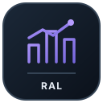
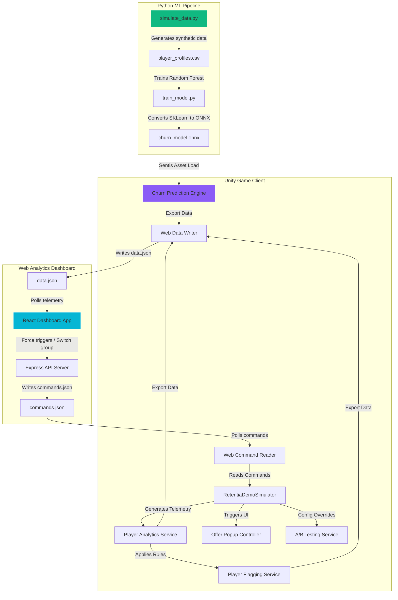

<p align="center">
  
</p>

<h1 align="center">Retentia AI: Live Player Retention &amp; Machine Learning Telemetry System</h1>

Retentia AI is an end-to-end player retention and analytics system designed for modern game developers. It features an **on-device Machine Learning inference engine (Unity Sentis)** coupled with a **rule-based flagging engine** that tracks player frustration and disengagement. The SDK communicates in real-time with a **React-based Web Dashboard** to display telemetry, spatial player death heatmaps, and allow developers to send remote commands or run multivariate A/B tests.

---


<p align="center"><a href="#system-architecture">🛠️ System Architecture</a> &nbsp;·&nbsp; <a href="#key-features">🌟 Key Features</a> &nbsp;·&nbsp; <a href="#codebase-tour">📂 Codebase Tour</a> &nbsp;·&nbsp; <a href="#running-the-project">🚀 Running the Project</a></p>

## 🛠️ System Architecture

The following diagram illustrates the real-time data loop between the Unity game client, Python training pipeline, and the React Web Dashboard:



---

## 🌟 Key Features

1. **On-Device Churn Prediction (Unity Sentis)**: Uses Scikit-Learn Random Forest classifiers converted to ONNX to compute real-time player churn probabilities directly on the player's device without server dependencies.
2. **Interactive Player Persona Simulator**: Built-in simulator with preset profiles (e.g. *Frustrated Rookie*, *Whale Spender*, *Casual Ad-Watcher*) that generates simulated telemetry, completes/fails levels, and records spatial positions.
3. **Live Spatial Heatmap & Fatality Logging**: Captures `(x, y)` coordinate tracking over time. Displays movement traces and animated skull markers of death locations on the dashboard's coordinate view.
4. **Dynamic Retention Campaigns (DOTween)**: Evaluates player frustration scores and risk indicators to present animated, timed offer popups that adapt to their segment.
5. **Bi-Directional Remote Overrides**: Trigger manual offer presentations or grant hard currency directly from the Web Dashboard to the Unity Game Client.
6. **A/B Testing Lab**: Oversee multivariate experimentation, assign variants (Control, Variant A: Hard Mode, Variant B: Easy Mode), and monitor sample sizes, retention rates, and statistical significance levels.

---

## 📂 Codebase Tour

- [Assets/_Retentia/Runtime/Core](file:///c:/Unity_Version/Retentia%20AI/Assets/_Retentia/Runtime/Core): Main engine architecture, locator registration, event bus, and the interactive simulator script.
- [Assets/_Retentia/Runtime/Analytics](file:///c:/Unity_Version/Retentia%20AI/Assets/_Retentia/Runtime/Analytics): Telemetry trackers, spatial analytics recorders, and frustration difficulty analysis.
- [Assets/_Retentia/Runtime/Intelligence](file:///c:/Unity_Version/Retentia%20AI/Assets/_Retentia/Runtime/Intelligence): Unity Sentis machine learning wrapper, player segmentation logic, and retention calculators.
- [_WebDashboard/src](file:///c:/Unity_Version/Retentia%20AI/_WebDashboard/src): Live React dashboard, Recharts telemetry charts, spatial Heatmaps, and Framer Motion layouts.
- [_ML_Tools](file:///c:/Unity_Version/Retentia%20AI/_ML_Tools): Python scripts for generating training sets and converting estimators to ONNX binaries.

---

## 🚀 Running the Project

### 1. Build and Export the ML Model (Python)
First, install dependencies, generate synthetic player data, and train the churn classifier:
```bash
# Install packages
pip install -r _ML_Tools/requirements.txt

# Generate synthetic dataset (player_profiles.csv)
python _ML_Tools/simulate_data.py

# Train Random Forest classifier and compile to ONNX
python _ML_Tools/train_model.py --input _ML_Tools/player_profiles.csv --output Assets/_Retentia/Resources/Models/churn_model.onnx
```

### 2. Start the Live Web Dashboard (Node.js & React)
Navigate to the web dashboard folder, install Node packages, and launch both the Node.js Express server and Vite development server:
```bash
cd _WebDashboard

# Install node dependencies
npm install

# Start Vite dev server & Express Command API
npm run dev & node server.js
```
The dashboard will be available at [http://localhost:5173](http://localhost:5173).

### 3. Run the Unity Simulation Client
1. Open the project in Unity (supports Unity 6 / Unity 2023+).
2. Open the scene `Assets/Scenes/SampleScene.unity`.
3. Press **Play** in the Unity Editor.
4. Toggle different **Player Personas** on the top-left OnGUI Simulator Panel and watch the Web Dashboard update in real-time.
5. In the dashboard, click **Force Trigger** or switch **A/B Testing Lab** overrides and watch the Unity Client receive and execute commands instantly.

---

## 🎨 Design Patterns & Clean Code

- **Service Locator**: Centralizes dependency management in `RetentiaServiceLocator.cs` for late-bound references.
- **Event Bus**: Implements a thread-safe, decoupled event publisher/subscriber pattern in `RetentiaEventBus.cs` to handle system actions cleanly.
- **SOLID Principles**: Highly modularized code splitting movement logging, difficulty analysis, ML inference, and file writing into single-responsibility, interface-driven components.
